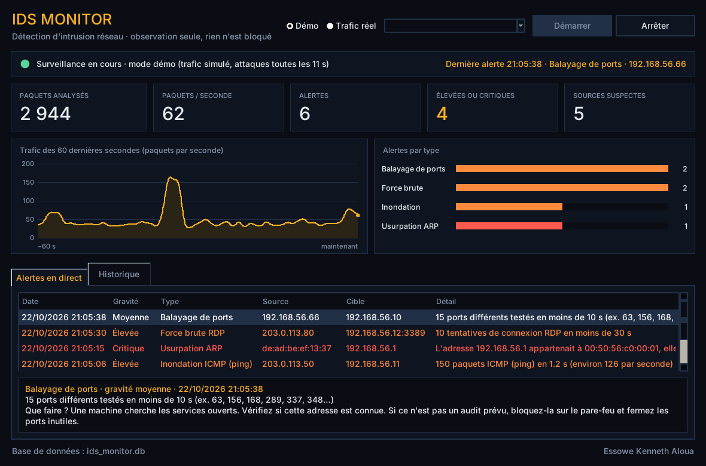

# IDS Monitor

Un système de détection d'intrusion réseau (IDS) avec une interface graphique Tkinter.
Il observe le trafic, repère quatre types d'attaques et garde l'historique des alertes.

Auteur : **Essowe Kenneth Aloua**. Version 2 (2026), réécriture complète de mon projet IDS Monitor de licence.



## C'est quoi un IDS ?

Un IDS joue le rôle d'une caméra de surveillance pour un réseau. Il regarde passer les paquets et
les compare à des comportements suspects connus. Il **ne bloque rien** : son travail est de repérer
et de prévenir, pour qu'un humain décide quoi faire.

## Ce qu'il détecte

| Attaque | Comment elle se voit | Règle par défaut | Gravité |
| --- | --- | --- | --- |
| Balayage de ports | Une machine teste beaucoup de ports pour trouver les services ouverts (comme Nmap) | 15 ports différents en 10 s | Moyenne ou élevée |
| Force brute SSH, RDP, FTP, Telnet | Beaucoup de tentatives de connexion pour deviner un mot de passe | 10 tentatives en 30 s | Élevée |
| Inondation (flood) ICMP ou SYN | Un volume énorme de paquets pour saturer une machine | 150 paquets en 5 s | Élevée |
| Usurpation ARP | Une adresse IP change soudain d'adresse MAC : signe d'une attaque de l'homme du milieu | Dès le premier changement | Critique |

Les seuils se règlent dans [`ids/config.py`](ids/config.py). Pour chaque alerte, l'application
explique ce qui s'est passé et **que faire**.

## Lancer le programme

Il faut Python 3.9 ou plus récent. Tkinter est fourni avec Python sous Windows.

### Mode démo (aucune installation)

```
python main.py --demo
```

Le mode démo simule un petit réseau d'entreprise et lance une attaque toutes les 11 secondes.
Aucun paquet n'est envoyé : tout reste dans le programme. Sous Windows, vous pouvez aussi
double-cliquer sur `lancer_demo.bat`.

### Trafic réel

1. Installez Scapy : `pip install -r requirements.txt`
2. Sous Windows, installez [Npcap](https://npcap.com) (il est aussi installé avec Wireshark).
3. Lancez le programme **en administrateur** (Linux : `sudo python3 main.py`).
4. Choisissez « Trafic réel », votre carte réseau, puis « Démarrer ».

Pour tester sans danger, utilisez un réseau qui vous appartient, par exemple deux machines
virtuelles : un balayage `nmap` depuis l'une doit déclencher une alerte sur l'autre.

## Organisation du code

```
main.py              point d'entrée
ids/
  config.py          seuils de détection
  modeles.py         Paquet, Alerte, Gravite
  capture.py         capture réelle (Scapy) et simulateur du mode démo
  detecteurs.py      les quatre règles de détection
  stockage.py        historique SQLite, export CSV
  interface.py       fenêtre Tkinter
tests/test_ids.py    14 tests automatiques
```

Le principe : la capture tourne dans un fil d'exécution séparé et dépose les paquets dans une
file d'attente. Toutes les 200 ms, l'interface vide la file, fait passer chaque paquet dans les
détecteurs, enregistre les alertes et met l'écran à jour. La fenêtre ne se bloque jamais.

Chaque détecteur utilise une **fenêtre glissante** : il ne garde que les événements des N
dernières secondes pour chaque source, puis compare leur nombre au seuil. Un délai de 30 s
évite de répéter la même alerte en boucle.

## Tests

```
python -m unittest -v
```

Les tests vérifient chaque règle (au-dessus et en dessous du seuil, trafic normal ignoré,
pas de doublon), la base de données et l'export CSV. Un dernier test rejoue toutes les attaques
de la démo et vérifie qu'aucune fausse alerte n'apparaît sur le trafic normal.

## Limites

- Les règles sont simples et reposent sur des seuils : un attaquant lent peut passer en dessous.
- Le trafic chiffré n'est pas inspecté, seulement ses en-têtes (adresses, ports, drapeaux).
- Pour un usage professionnel, on utiliserait Suricata ou Zeek. Ce projet sert à comprendre
  comment ces outils fonctionnent.
